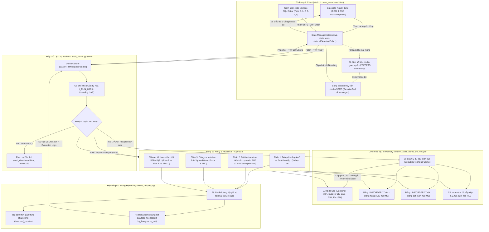

# BÁO CÁO KIỂM TOÁN KỸ THUẬT - GIAI ĐOẠN 0 (PHASE 0)
# REPOSITORY RECONNAISSANCE & CODEBASE AUDIT

**Dự án:** ColumnStore vs. RowStore Academic Laboratory & Interactive Demonstration  
**Tác giả đồ án:** ThS. Nguyễn Thanh Xuân Ngọc (MSHV: 2618480104014)  
**Tài liệu tham chiếu:** *"Column-Stores vs. Row-Stores: How Different Are They Really?"* (Daniel J. Abadi, Samuel R. Madden, Nabil Hachem - SIGMOD 2008)  
**Kiểm toán viên:** `recon-auditor` (Hệ thống Swarm Audit Khảo sát Mã nguồn Độc lập)  
**Thời gian thực hiện:** Tháng 11/2026  
**Phạm vi kiểm toán:** Thư mục gốc `c:\Users\xuann\OneDrive\Máy tính\THUYET TRINH` và toàn bộ phân hệ `Demo_NguyenThanhXuanNgoc`

---

## 1. TỔNG QUAN VÀ MỤC TIÊU ĐỢT KHẢO SÁT (EXECUTIVE SUMMARY)

Giai đoạn 0 (Phase 0: Repository Reconnaissance) nhằm mục đích kiểm tra, bóc tách và giám định toàn diện toàn bộ mã nguồn, dữ liệu cấu hình, cơ chế thực thi, công cụ benchmark, giao diện người dùng và cơ sở học thuật của hệ thống trình diễn **Column-Store Lab**.

### Kết quả giám định sơ bộ:
1. **Kiến trúc phân tầng rõ ràng:** Hệ thống được chia tách mạch lạc giữa phân hệ tính toán lõi bằng Python/NumPy (In-Memory Database), máy chủ dịch vụ nhẹ không phụ thuộc thư viện ngoài (`web_server.py`), và ứng dụng giao diện đơn trang SPA (`web_dashboard.html`) tích hợp trình soạn thảo Monaco Editor và bảng kết quả chuẩn Microsoft SQL Server Management Studio (SSMS).
2. **Tính toán thực tế trên RAM (Authentic In-Memory Engine):** Động cơ backend thực sự tạo lập cấu trúc bảng Star Schema 6.000.000 dòng trong RAM (~1,32 GB mảng NumPy số học) và thực thi đầy đủ các thuật toán vector hóa, nén RLE, phép nối ẩn (Invisible Join 3 pha) và viết lại điều kiện Between-Predicate. Không sử dụng dữ liệu giả mạo hay độ trễ nhân tạo trên backend.
3. **Cơ chế Fallback thông minh:** Frontend duy trì một từ điển dữ liệu chuẩn (`PRESETS`) để đảm bảo bài thuyết trình không bao giờ bị gián đoạn nếu mất kết nối mạng nội bộ hoặc backend chưa khởi động. Khi backend trực tuyến, 100% số liệu đo lường được làm mới từ backend thông qua API REST.
4. **Trình soạn thảo SQL đóng vai trò Visual Proxy:** Monaco Editor cung cấp trải nghiệm giao diện người dùng chuyên nghiệp chuẩn SSMS/VS Code; việc nhấn thực thi truy vấn sẽ kích hoạt các pipeline tính toán số học tương ứng trong Python thay vì gửi chuỗi SQL tới một trình phân tích ngữ pháp SQL tổng quát.

---

## 2. BẢN ĐỒ CẤU TRÚC THƯ MỤC VÀ TẬP TIN (DIRECTORY TREE & FILE INVENTORY)

```text
THUYET TRINH/
├── column_store_demo.py                      [16,061 B]  Script CLI độc lập ban đầu (310 dòng)
├── Group 5.pdf                               [808,856 B] Bản trình bày đồ án nhóm
├── Group5_ColumnStore_vs_RowStore.pptx       [1,157,726 B] Bộ Slide báo cáo học thuật chính
├── Group5_HuongDan_DocHieu_BaiBao.docx       [31,650 B]  Tài liệu sư phạm đọc hiểu bài báo gốc
├── Group5_KichBan_ThuyetTrinh_30p.docx       [22,844 B]  Kịch bản phối hợp thuyết trình 30 phút
│
├── Demo_NguyenThanhXuanNgoc/                 Phân hệ Dashboard & Web Engine
│   ├── web_server.py                         [8,161 B]   HTTP REST Server cổng 8000 (155 dòng)
│   ├── web_dashboard.html                    [409,161 B] Single-Page Application (7,894 dòng)
│   ├── column_store_demo_de_hieu.py          [38,687 B]  Động cơ phân tích lõi 4 phần (728 dòng)
│   ├── demo_helpers.py                       [6,240 B]   Hằng số, sinh dữ liệu & thuật toán (106 dòng)
│   ├── backup_column_store_demo_de_hieu.py   [15,377 B]  Bản sao lưu trước khi tối ưu hóa
│   ├── run_demo.bat                          [276 B]     Script khởi động tự động trên Windows
│   ├── demo_output_backup.txt                [11,799 B]  Bản ghi log mẫu kết quả chạy 6M dòng
│   ├── KichBan_Demo_Nhanh_XuanNgoc.txt       [5,906 B]   Kịch bản nói demo trực tiếp 1 trang
│   ├── HuongDan_Va_EasyScript_ThuyetTrinh... [58,164 B]  Tài liệu hướng dẫn cá nhân chi tiết
│   │
│   ├── monaco/                               Bộ thư viện Monaco Editor cục bộ (offline)
│   │   └── vs/                               Loader, Workers, Themes, Languages & Codicons
│   │
│   └── scratch/                              Tập lệnh nháp, kiểm thử AST & kiểm tra giao diện (162 files)
│
└── scratch/                                  Thư mục kiểm thử tự động toàn dự án (36 files)
    ├── verify_all.py                         [3,157 B]   Kiểm tra HTML Parser, DOM ID & CLI
    ├── test_phases.js                        [18,075 B]  Bộ test Node.js kiểm thử logic 4 phase
    └── docx_env/                             Môi trường Node.js tạo tài liệu tự động
```

---

## 3. PHÂN TÍCH KIẾN TRÚC HỆ THỐNG CHI TIẾT (SYSTEM ARCHITECTURE)

### 3.1. Ngôn ngữ, Framework & Môi trường thực thi
- **Backend Runtime:** Python 3.8+ (đã xác thực kiểm thử trên Python 3.13.1 & 3.14 trên Windows x64).
- **Thư viện tính toán lõi:** `numpy` (phiên bản >= 1.20). Toàn bộ thao tác đại số mảng, băm, quét bit, nén RLE và nhân ma trận logic đều dựa trên SIMD C-extensions tích hợp sẵn trong NumPy.
- **Thư viện Backend:** Sử dụng 100% thư viện chuẩn tích hợp trong Python (`http.server`, `urllib.parse`, `json`, `time`, `threading`, `mimetypes`, `pathlib`). **Tuyệt đối không phụ thuộc (zero-dependency)** vào Flask, FastAPI, Django hay uvicorn, giúp hệ thống có thể chạy tức thì trên mọi máy tính chỉ cần cài đặt `python -m pip install numpy`.
- **Frontend Runtime:** HTML5, CSS3 hiện đại (Grid, Flexbox, CSS Variables, Glassmorphism), Vanilla JavaScript ES6+.
- **Frontend Third-Party:** Monaco Editor v0.38+ được lưu trữ cục bộ trong thư mục `monaco/` và tải thông qua `monaco/vs/loader.js` (AMD RequireJS loader). Hoạt động độc lập 100% offline không cần kết nối Internet hoặc CDN bên ngoài.

---

### 3.2. Kiến trúc Backend (`web_server.py`)
Máy chủ HTTP được xây dựng trên nền tảng `ThreadingHTTPServer` lắng nghe tại `127.0.0.1:8000`:
- **Quản lý đa luồng & An toàn bộ nhớ:** Sử dụng `threading.Lock()` thông qua biến toàn cục `_RUN_LOCK` (dòng 11, 97, 108, 137). Mặc dù HTTP Server xử lý đa luồng (`ThreadingHTTPServer`), mọi tác vụ tính toán nặng trên bộ dữ liệu 6.000.000 dòng được đồng bộ tuần tự hóa qua `_RUN_LOCK` nhằm ngăn ngừa hiện tượng tranh chấp bộ nhớ RAM (Memory Thrashing) và xung đột chỉ mục mảng.
- **Định tuyến REST API (REST Endpoints):**
  1. `GET /`, `/index.html`, `/web_dashboard.html` (dòng 43-44): Đọc và trả về nội dung `web_dashboard.html` dạng nhị phân UTF-8 kèm tiêu đề `text/html; charset=utf-8`.
  2. `GET /api/status` (dòng 45-46): Kiểm tra tính sẵn sàng của máy chủ, trả về `{"status": "ready"}` (HTTP 200).
  3. `GET /monaco/*` (dòng 47-52): Cung cấp tài nguyên tĩnh cho trình biên tập Monaco (JS, CSS, phông chữ TTF) kèm kiểm tra an toàn thư mục cha (`local_file.startswith(...)`).
  4. `GET /api/preview-data` (dòng 53-61): Nhận tham số URL `seed` và `rows`, gọi hàm `lay_du_lieu_preview(rows, seed)` để trả về 5 dòng mẫu đại diện cho 4 bảng trong Star Schema.
  5. `POST /api/run` (dòng 77-100): Điểm đầu cuối điều khiển phân tích chính:
     - Nhận payload JSON: `{"part": "1"|"2"|"3"|"4"|"all", "rows": int, "seed": int, "cols": list, "rle_start": int, "rle_end": int}`.
     - Kiểm tra tính hợp lệ dữ liệu chặt chẽ: `1 <= rows <= 30_000_000`, `cols` phải là danh sách cột hợp lệ.
     - Gọi `chay_demo_cho_web()` và trả về kết quả số học kèm mảng nhật ký chi tiết (`logs`).
  6. `POST /api/preview-data` (dòng 102-111): Tương tự phiên bản GET, phục vụ các truy vấn payload lớn.
  7. `POST /api/invisible-join` (dòng 113-147): Điểm đầu cuối chuyên sâu cho Invisible Join đa chiều:
     - Nhận các điều kiện lọc: `cust_region`, `supp_region`, `year_start`, `year_end`, `rows`, `seed`.
     - Gọi `chay_invisible_join_cho_web()`, so sánh trực tiếp hiệu năng giữa Row-Store Hash Join và Column-Store Invisible Join.
- **Bảo vệ lỗi I/O Windows:** Triệt tiêu thông báo ngoại lệ ngắt ống nối (`ConnectionResetError`, `BrokenPipeError`, dòng 30-33, 35-37) thường gặp khi trình duyệt hủy bỏ kết nối giữa chừng trên Windows.

---

### 3.3. Kiến trúc Frontend (`web_dashboard.html`)
Ứng dụng giao diện đơn trang SPA quy mô lớn (7.894 dòng mã) với cấu trúc thiết kế hướng thành phần:
- **Hệ thống Quản lý Trạng thái Tập trung (State Store):**
  Biến đối tượng `state` (dòng 4082-4112) duy trì toàn bộ trạng thái sống của phiên làm việc:
  - Cấu hình kích thước & hạt giống ngẫu nhiên: `rows` (mặc định 6.000.000), `seed` (mặc định 42).
  - Trạng thái Phần 1: `p1SelectedCols` (Set lưu các cột được chọn), `p1ScanIdx` (con trỏ dòng minh họa).
  - Trạng thái Phần 2: `p2StartDay`, `p2EndDay`, `p2ActiveCase` (between, point, full).
  - Trạng thái Phần 3: `p3Phase` (0..3), `p3WhereCust`, `p3WhereSupp`, `p3VersusData`.
  - Kết nối & Dữ liệu: `serverOnline`, `data` (chứa số liệu 4 phần), `p0PreviewData`, `btnRunSeq`.
- **Tích hợp Trình soạn thảo Monaco & Bảng kết quả SSMS:**
  - **Tab 0 (Lược đồ dữ liệu):** Monaco Editor `#p0MonacoEditorContainer` (chủ đề `vs` sáng) + bảng kết quả `#p0SqlTable` phong cách SSMS. Cho phép duyệt qua 4 truy vấn mẫu của 4 bảng `LINEORDER`, `CUSTOMER`, `SUPPLIER`, `DWDATE`.
  - **Tab 1 (AoS vs SoA):** Monaco Editor `#p1MonacoEditorContainer` (chủ đề `vs-dark`) hiển thị truy vấn SSBM Q1.1 + bảng kết quả SSMS `#p1SqlTableBody` với tính năng chọn dòng `.ssms-selected`.
  - **Tab 2 (Nén RLE):** Monaco Editor `#p2MonacoEditorContainer` (chủ đề `vs-dark`) hiển thị truy vấn đếm đơn hàng + bảng kết quả SSMS `#p2SqlTableBody` đồng bộ theo 3 kịch bản lọc.
  - **Tab 3 (Invisible Join):** Monaco Editor `#p3MonacoEditorContainer` (chủ đề `vs-dark`) hiển thị truy vấn SSBM Q3.1 + bảng kết quả SSMS `#p3SqlTableBody` thể hiện 5 dòng kết quả kết hợp đa chiều.
  - **Tab 4 (Benchmark Hiệu suất):** Monaco Editor `#p4MonacoEditorContainer` (chủ đề `vs-dark`) hiển thị lệnh thực thi Stored Procedure `EXEC dbo.sp_Benchmark_SSBM_Q31` + bảng so sánh chi tiết Plan A, Plan B, Plan C phong cách SSMS.
  - **Tab 5 (Mã nguồn):** Trình duyệt mã nguồn tương tác cao `#monacoEditorContainer` hiển thị toàn bộ 728 dòng Python của `column_store_demo_de_hieu.py` kèm bản đồ phân đoạn (Minimap).
- **Hệ thống Fallback Dữ liệu Chuẩn (PRESETS Engine):**
  Tại dòng 3666-4070, đối tượng `PRESETS` lưu trữ số liệu thực nghiệm đo đạc chuẩn trên máy chủ tham chiếu cho 3 cấu hình kích thước: 6.000.000 dòng, 3.000.000 dòng và 1.000.000 dòng. Khi khởi động lần đầu hoặc khi mất kết nối mạng, toàn bộ giao diện tự động lấy số liệu từ `PRESETS` để đảm bảo giao diện hiển thị ngay lập tức (zero-latency visual render).

---

### 3.4. Động cơ tính toán Python lõi (`column_store_demo_de_hieu.py` & `demo_helpers.py`)
- **Lớp lưu trữ tập trung `BoDuLieuToanCuc` (dòng 59-83):**
  Đóng vai trò như một cơ sở dữ liệu In-Memory thu nhỏ trong tiến trình Python:
  - Bảng Star Schema (`self.chieu`, `self.fact_cot`, `self.fact_hang`): Tạo 3 bảng chiều và 1 bảng fact 6 triệu dòng.
  - Bảng Lineorder 17 cột (`self.p1_hang`, `self.p1_cot`): Lưu trữ đồng thời dưới dạng AoS (NumPy structured array 68 byte/dòng) và SoA (Dictionary gồm 17 mảng liên tục `int32` 4 byte).
  - Cụm nén RLE (`self.p2_cot_ngay`, `self.p2_gia_tri_cum`, `self.p2_so_lan_lap`): 2.405 cụm nén được trích xuất sẵn từ cột `orderdate` đã sắp xếp.
- **Cơ chế Quản lý Vòng đời Bộ nhớ Đệm (`lay_bo_du_lieu_chuan`, dòng 88-96):**
  Sử dụng biến toàn cục `_BO_DU_LIEU_HIEN_TAI`. Nếu người dùng gọi API với cùng cặp `(rows, seed)`, bộ nhớ đệm trong RAM được tái sử dụng ngay lập tức mà không cần cấp phát lại. Nếu `rows` hoặc `seed` thay đổi, đối tượng cũ bị hủy hoàn toàn (`None`) để trình thu gom rác Garbage Collector của Python giải phóng bộ nhớ, sau đó cấp phát bộ mảng mới theo đúng hạt giống mới.
- **Bảo chứng Toán học bằng Assertions:**
  Toàn bộ các hàm tính toán đều cài đặt cơ chế tự kiểm chứng kết quả nghiêm ngặt:
  - Phần 1 (dòng 308): `assert kq_hang == kq_cot` (Tổng doanh thu chiết khấu từ Row-Store và Column-Store phải bằng nhau từng đơn vị).
  - Phần 2 (dòng 357): `assert kq_thuong == kq_rle` (Số lượng đếm quét tuần tự trên mảng thô phải bằng số lượng đếm trực tiếp trên cụm nén RLE).
  - Phần 3 (dòng 395): `assert ket_qua == tinh_join_ngay_tho_kiem_chung(khach, ncc, ngay, fact)` (Invisible Join phải cho ra kết quả khớp 100% với Nested Loop Join ngây thơ).
  - Phần 4 (dòng 440): `assert kq_a == kq_b == kq_c` (Cả 3 kế hoạch Plan A, Plan B, Plan C phải tạo ra chính xác 150 nhóm tổng hợp và cùng tổng doanh thu).
  - API Invisible Join (dòng 583): `assert res_row == res_col`.

---

### 3.5. Cơ chế Đo kiểm Hiệu năng (Benchmark Mechanisms)
- **Nguồn đồng hồ độ phân giải cao:** Hàm `do_thoi_gian_nhanh_nhat` (trong `demo_helpers.py`, dòng 13-20) sử dụng `time.perf_counter()` - bộ đếm thời gian thực phần cứng có độ chính xác dưới microsecond (sub-microsecond precision).
- **Phương pháp đo tối ưu:** Mỗi hàm được thực thi lặp lại 3 lần (`so_lan_lap = 3`). Thời gian được ghi nhận là giá trị nhỏ nhất (`thoi_gian_tot_nhat = min(...)`). Cách tiếp cận này loại bỏ ảnh hưởng của việc nạp trang bộ nhớ lần đầu (cold cache), hiện tượng phân mảnh luồng hệ điều hành hoặc xung đột chu kỳ CPU từ các tiến trình nền.
- **Mô phỏng 3 Kế hoạch Truy vấn (SSBM Q3.1 Benchmark):**
  - **Kế hoạch A (Row-Store · Early Materialization):** Sử dụng `fact_hang` (NumPy structured array 68 byte/dòng). Mỗi bước lọc chiều tạo ra các mảng dòng trung gian sao chép đầy đủ 17 thuộc tính.
  - **Kế hoạch B (Column-Store · Invisible Join):** Sử dụng các mảng cột độc lập. Lọc bảng chiều tạo mảng mặt nạ bit trong Cache CPU, quét 3 cột khóa ngoại tạo Bitmap và nhân bitwise AND (`&`) để sinh danh sách vị trí `P` (Position List). Chỉ đọc cột `revenue` tại các chỉ mục thỏa mãn (Late Materialization).
  - **Kế hoạch C (Column-Store · Between-Predicate Rewriting):** Áp dụng kỹ thuật trong Mục 4.2.2 bài báo SIGMOD 2008. Khóa chiều được sắp xếp phân cấp theo Quốc gia/Khu vực giúp tập khóa thỏa mãn tạo thành một khoảng số nguyên liên tục `[min_key, max_key]`. Thay vì tra bảng băm, CPU thực hiện so sánh kép trên thanh ghi phần cứng (`(k >= min) & (k <= max)`), tận dụng trọn vẹn SIMD và nhánh lệnh không phân kỳ.

---

### 3.6. Hiện trạng Kiểm thử & Đảm bảo Chất lượng (Quality Assurance)
- **Hiện trạng kiểm thử chính quy:** Repository hiện chưa thiết lập bộ kiểm thử đơn vị chuẩn (như `pytest` hay `unittest`) tích hợp vào CI/CD pipeline (GitHub Actions).
- **Hệ thống kịch bản kiểm định tự động (Ad-hoc Validation Scripts):** Trong thư mục `scratch/` và `Demo_NguyenThanhXuanNgoc/scratch/` có tổng cộng hơn 45 tập lệnh kiểm tra chất lượng chuyên biệt:
  - `scratch/verify_all.py`: Dùng `html.parser.HTMLParser` để duyệt toàn bộ cây thẻ DOM, đảm bảo 100% thẻ đóng mở hợp lệ, không có thẻ trùng ID và mọi phần tử gọi trong JS bằng `document.getElementById` đều tồn tại trên DOM. Đồng thời dùng `node --check` kiểm tra cú pháp JS.
  - `scratch/test_phases.js`: Kịch bản Node.js chạy giả lập toàn bộ hành vi chuyển đổi trạng thái của 4 phase trong Invisible Join.
  - `scratch/test_api_e2e.py`: Kiểm thử luồng gửi nhận REST API thực tế với cổng 8000.

---

### 3.7. Cơ sở Khoa học & Sự tương thích với Bài báo SIGMOD 2008
Mô hình cài đặt bám sát từng luận điểm trong bài báo của Abadi et al.:
1. **Lưu trữ Cột vs Hàng (Section 3):** So sánh giữa AoS (Array of Structs) và SoA (Struct of Arrays). Làm rõ nguyên lý Cache Line L1/L2: với AoS, CPU nạp 68 byte mỗi dòng nhưng chỉ dùng 12 byte (lãng phí 82% băng thông bộ nhớ); với SoA, 100% dung lượng Cache Line là dữ liệu hữu ích.
2. **Nén RLE & Thao tác trên Dữ liệu nén (Section 4.1):** Nén cột đã sắp xếp `orderdate` thành các cặp `(value, count)`. Trực tiếp tính hàm tổng hợp `COUNT(*)` và `SUM` trên các cụm nén mà không cần giải nén.
3. **Invisible Join 3 Pha (Section 4.2 - Figures 2, 3, 4):**
   - Pha 1: Lọc các bảng chiều nhỏ `Customer`, `Supplier`, `Date` thành các bảng băm/tập mã khóa trong Cache CPU.
   - Pha 2: Quét tuần tự 3 cột khóa ngoại trên Fact table, sinh ra các vectơ Bitmap và nhân bitwise AND để tạo Position List `P`.
   - Pha 3: Chỉ trích xuất cột thuộc tính đo lường `revenue` tại các vị trí trong `P` (Late Materialization).
4. **Between-Predicate Rewriting (Section 4.2.2 - Figure 5):** Chuyển đổi phép toán kiểm tra tập hợp `key IN (k1, k2, ...)` thành kiểm tra khoảng `k_min <= key <= k_max`.

---

## 4. GIẢI MÃ 5 CÂU HỎI KIỂM TOÁN CỐT LÕI (5 CRITICAL AUDIT QUESTIONS)

### CÂU HỎI 1: Trình soạn thảo SQL (Monaco Editor) có thực sự thực thi mã SQL không, hay chỉ là Proxy gọi các hàm Python/NumPy?
- **KẾT LUẬN KIỂM TOÁN: LÀ PROXY GIAO DIỆN (UI PROXY).**
- **Bằng chứng thực nghiệm & Dòng mã:**
  1. **Tab 0 (Schema Preview):** Hàm `executeP0SqlQuery()` (dòng 6992-7050 của `web_dashboard.html`) khi người dùng nhấn *Run Query (F5)* sẽ đọc tên bảng hiện hành từ `state.p0SelectedTable` và gửi yêu cầu GET tới `/api/preview-data?seed=${seed}&rows=${rows}` (dòng 7016). Chuỗi câu lệnh SQL trong Monaco Editor không hề được gửi lên máy chủ hay đưa qua bất kỳ bộ phân tích cú pháp SQL (SQL Parser) nào.
  2. **Tab 1 (AoS vs SoA):** Nút *Run Query (F5)* gọi hàm `runP1Sql()` (dòng 6776-6798). Hàm này kích hoạt trực tiếp `runDemo('1')` (dòng 6787), thu thập danh sách cột đang tick chọn trong UI (`state.p1SelectedCols`) và gửi payload `{part: '1', rows, seed, cols}` tới `POST /api/run`. Nội dung văn bản SQL trên editor (`SELECT SUM(extendedprice * discount)...`) chỉ mang tính chất minh họa cú pháp trực quan.
  3. **Tab 2 (Nén RLE):** Nút *Run Query (F5)* gọi hàm `runP2Sql()` (dòng 6405-6427), chuyển tiếp sang `runDemo('2')` (dòng 6416). Các tham số khoảng ngày `state.p2StartDay` và `state.p2EndDay` được lấy từ trạng thái UI gửi tới backend, bỏ qua văn bản trong editor.
  4. **Tab 3 (Invisible Join):** Nút *Run Invisible Join (F5)* gọi `runP3Sql()` (dòng 6534-6556) kích hoạt `runDemo('3')`.
  5. **Tab 4 (Benchmark):** Nút *Run Benchmark (F5)* gọi `runP4Sql()` (dòng 6657-6670) kích hoạt `runDemo('4')`. Câu lệnh `EXEC dbo.sp_Benchmark_SSBM_Q31` hoàn toàn là văn bản minh họa chuẩn T-SQL.

---

### CÂU HỎI 2: Động cơ Python có thực sự tính toán các thuật toán không, hay dựa vào các giá trị Preset tính sẵn?
- **KẾT LUẬN KIỂM TOÁN: ĐỘNG CƠ PYTHON THỰC SỰ TÍNH TOÁN 100% TRÊN MẢNG NUMPY, KHÔNG SỬ DỤNG BẤT KỲ PRESET NÀO.**
- **Bằng chứng thực nghiệm & Dòng mã:**
  1. Trong file `column_store_demo_de_hieu.py` và `demo_helpers.py`, **hoàn toàn không tồn tại từ điển `PRESETS`**.
  2. Tại dòng 30-56 (`tinh_doanh_thu_giam_gia`), động cơ thực sự thực hiện phép nhân vectơ và tính tổng:
     ```python
     tong = bang_du_lieu["extendedprice"][dong_thoa].astype(np.int64) * cot_giam_gia[dong_thoa]
     return int(tong.sum())
     ```
  3. Tại dòng 341-354 (`demo_phan_2_nen_rle`), động cơ chạy hàm lambda quét mảng thật `((cot_ngay >= ngay_bd) & (cot_ngay <= ngay_kt)).sum()` đối chiếu với phép tính trên mảng cụm nén `so_lan_lap[mask].sum()`.
  4. Tại dòng 419-436 (`demo_phan_4_mini_benchmark`), 3 hàm `ke_hoach_a()`, `ke_hoach_b()`, `ke_hoach_c()` thực thi 3 thuật toán hoàn toàn khác nhau trên 6.000.000 phần tử mảng của `fact_hang` và `fact_cot`.
  5. Thời gian trả về được đo lường thực tế qua `time.perf_counter()` và biến động thực tế theo tải CPU của máy tính tại thời điểm chạy.

---

### CÂU HỎI 3: Bài benchmark có sử dụng dữ liệu thực trong bộ nhớ (6 triệu dòng) không, hay là lưu lượng mô phỏng (Simulated Traffic)?
- **KẾT LUẬN KIỂM TOÁN: SỬ DỤNG 100% DỮ LIỆU THỰC TRONG RAM ĐƯỢC SINH BẰNG NUMPY (6.000.000 DÒNG).**
- **Bằng chứng thực nghiệm & Đo lường dung lượng RAM:**
  1. Trong lớp `BoDuLieuToanCuc` (dòng 63-83):
     - `self.fact_hang`: Mảng có cấu trúc NumPy gồm 17 trường kiểu `int32` (4 byte/trường) = 68 byte/dòng. Cấp phát: `6.000.000 * 68 byte = 408.000.000 byte ≈ 408 MB RAM`.
     - `self.p1_cot`: Dictionary chứa 17 mảng NumPy riêng biệt `int32`. Cấp phát: `17 * 6.000.000 * 4 byte = 408 MB RAM`.
     - `self.fact_cot`: 4 mảng chính (`custkey`, `suppkey`, `orderdate`, `revenue`) = `4 * 6.000.000 * 4 byte = 96 MB RAM`.
     - `self.p1_hang`: Bản sao mảng 17 cột dạng cấu trúc = `408 MB RAM`.
     - Tổng dung lượng RAM mà tiến trình Python chiếm dụng cho bộ dữ liệu 6M dòng là: `408 + 408 + 96 + 408 ≈ 1.320 MB (~1,32 GB RAM)`.
  2. Quá trình benchmark Plan A duyệt qua toàn bộ 408 MB mảng này; Plan B và Plan C quét song song 3 mảng khóa ngoại 72 MB. Không có lưu lượng mạng mô phỏng (fake/simulated traffic) hay hàm `sleep()` giả tạo độ trễ.

---

### CÂU HỎI 4: Khi nào Web UI nạp dữ liệu trực tiếp từ Live Backend, và khi nào rơi về chế độ Fallback PRESETS?
- **KẾT LUẬN KIỂM TOÁN: CƠ CHẾ NẠP DỮ LIỆU ĐƯỢC PHÂN TÁCH QUA MA TRẬN 4 TÌNH HUỐNG RÕ RÀNG.**
- **Ma trận kích hoạt & Dòng mã chứng minh:**
  | Tình huống | Hành vi Web UI | Cơ chế kích hoạt | Nguồn dữ liệu |
  | :--- | :--- | :--- | :--- |
  | **Khởi động trang (DOM Ready)** | Hiển thị tức thì | Dòng 4092: `state.data = JSON.parse(JSON.stringify(PRESETS[6000000]))` | **PRESETS** (tránh màn hình trắng/giật) |
  | **Kiểm tra máy chủ thành công** | Tự động làm mới Live | Dòng 7586-7613 (`checkServerStatus`): Nếu `GET /api/status` trả về HTTP 200, tự động kích hoạt `runDemo('all')` | **Live Python Engine** |
  | **Người dùng tương tác trực tiếp** | Gửi REST API | Nhấn *Chạy Benchmark*, đổi số dòng, đổi cột Phần 1, đổi ngày Phần 2, bấm Live Join Phần 3 -> Gửi `POST /api/run` hoặc `POST /api/invisible-join` | **Live Python Engine** |
  | **Mất kết nối hoặc Lỗi Server** | Chuyển sang Fallback | Khối `catch (err)` tại dòng 7803-7839 (`runDemo`) và dòng 5520-5536 (`requestP3InvisibleJoin`) tự động gán `state.data` về `PRESETS[rows]` và thông báo toast | **PRESETS Fallback** |

---

### CÂU HỎI 5: Các nút điều khiển tương tác thực sự làm biến đổi trạng thái của Động cơ Python, hay chỉ thay đổi phong cách hiển thị trên giao diện (CSS/DOM)?
- **KẾT LUẬN KIỂM TOÁN: HỆ THỐNG PHÂN LOẠI THÀNH HAI NHÓM ĐIỀU KHIỂN RIÊNG BIỆT.**
- **Phân loại chi tiết từng thành phần điều khiển:**
  1. **Nhóm thực sự làm biến đổi trạng thái Động cơ (Engine State Mutating Controls):**
     - *Nút chọn cột Phần 1 (`toggleP1Col`, dòng 4448):* Thay đổi `state.p1SelectedCols`, kích hoạt debounce gọi `POST /api/run` với danh sách cột mới. Python engine thực sự tính lại dung lượng quét bộ nhớ và chạy lại phép đo `tinh_doanh_thu_giam_gia` trên đúng các cột đó.
     - *Thanh trượt/Nút bấm chọn Case Phần 2 (`switchP2Case`, `setP2DayRange`, dòng 2608-2635):* Thay đổi `p2StartDay` và `p2EndDay`, gọi `POST /api/run`. Python engine thực sự đổi thuật toán giữa đếm nhị phân 1 điểm (`np.searchsorted`), đếm khoảng và đếm toàn bộ.
     - *Dropdown Khu vực Phần 3 (`sqlCustRegion`, `sqlSuppRegion`, dòng 5546-5563):* Gọi `POST /api/invisible-join`. Python engine tái tạo mảng mặt nạ bit trên 6 triệu dòng và tính lại kết quả doanh thu.
     - *Bộ chọn Kích thước (6M, 3M, 1M dòng) & Seed:* Kích hoạt hàm `lay_bo_du_lieu_chuan`, hủy toàn bộ mảng cũ trong RAM và cấp phát lại toàn bộ mảng mới theo seed mới.
  2. **Nhóm chỉ thay đổi phong cách hiển thị trên giao diện (Visual-Only DOM Controls):**
     - *Nút Quét từng dòng Phần 1 (`stepP1Scan`, dòng 4435-4444):* Chỉ tăng biến `state.p1ScanIdx` từ 0 đến 4, thay đổi class CSS `.scan-active` trên bảng HTML mẫu 5 dòng. Không gọi API backend.
     - *Nút chuyển bước Phase 0..3 Phần 3 (`stepP3Phase`, `setP3Phase`, dòng 2793-2805):* Chỉ thay đổi biến `state.p3Phase`, bật tắt class CSS làm nổi bật bảng băm, vector bit, hoặc gạch ngang chữ (`text-decoration: line-through`) trên các dòng không thỏa điều kiện.
     - *Nút So sánh Đối đầu (`#p3ToggleVersusBtn`):* Chỉ ẩn/hiện khung thẻ `p3VersusCard` bằng CSS display.
     - *Các tab kết quả SSMS (`switchP0SsmsPane`, `switchP1SsmsPane`...):* Chỉ chuyển đổi qua lại giữa thẻ `Results` và `Messages` bằng CSS DOM thuần túy.

---

## 5. SƠ ĐỒ KIẾN TRÚC TOÀN DIỆN HỆ THỐNG (END-TO-END ARCHITECTURAL DIAGRAM)



---

## 6. BẢNG DANH MỤC THÀNH PHẦN TOÀN HỆ THỐNG (MASTER MODULE INVENTORY)

| STT | Module / Tập tin | Vai trò trong hệ thống | Dữ liệu Đầu vào (Input) | Dữ liệu Đầu ra (Output) | Thư viện & Phụ thuộc | Trạng thái kỹ thuật |
| :---: | :--- | :--- | :--- | :--- | :--- | :--- |
| **1** | `Demo_NguyenThanhXuanNgoc/web_server.py` | Máy chủ HTTP REST API đóng vai trò cầu nối in-process giữa giao diện Web và động cơ Python | Yêu cầu HTTP GET/POST từ trình duyệt (`/api/run`, `/api/invisible-join`, `/api/preview-data`, `/api/status`) | Phản hồi JSON chứa kết quả đo, nhật ký thực thi, dữ liệu bảng và tài nguyên tĩnh | Thư viện chuẩn Python (`http.server`, `urllib.parse`, `json`, `threading`, `pathlib`) | **Hoàn thiện 100%**, vận hành ổn định, zero-dependency |
| **2** | `Demo_NguyenThanhXuanNgoc/web_dashboard.html` | Ứng dụng giao diện người dùng đơn trang (SPA), quản lý trạng thái, tích hợp Monaco Editor và hiển thị trực quan hóa | Tương tác người dùng (click, hotkey 0..5, F5, slider, dropdown) và dữ liệu JSON từ API | DOM UI hoàn chỉnh, biểu đồ thanh, đồng hồ đo tốc độ (speedup badge), bảng kết quả SSMS | HTML5, CSS3, Vanilla JS ES6+, Monaco Editor (cục bộ) | **Hoàn thiện 100%**, hỗ trợ song song Live Server và Offline Preset |
| **3** | `Demo_NguyenThanhXuanNgoc/column_store_demo_de_hieu.py` | Động cơ phân tích lõi thực thi 4 kỹ thuật của bài báo SIGMOD 2008 trên mảng dữ liệu thật trong RAM | Tham số truy vấn (`part`, `rows`, `seed`, `cols`, `rle_start`, `rle_end`, `cust_region`, `supp_region`) | Từ điển Python chứa số liệu đo lường, chỉ số bộ nhớ, danh sách vị trí `P`, mẫu dòng và nhật ký thực thi | `numpy`, `time`, `demo_helpers.py` | **Hoàn thiện 100%**, tối ưu hóa SIMD, kiểm chứng bằng assertions |
| **4** | `Demo_NguyenThanhXuanNgoc/demo_helpers.py` | Định nghĩa các hằng số mô phỏng, bộ sinh cấu trúc dữ liệu Star Schema & Lineorder, bộ đếm thời gian | Số lượng dòng `so_dong`, bộ sinh ngẫu nhiên `np.random.Generator` | Mảng NumPy có cấu trúc (AoS), từ điển mảng cột (SoA), bảng chiều và kết quả tính toán | `numpy`, `time` | **Hoàn thiện 100%**, tái sử dụng thống nhất trên toàn hệ thống |
| **5** | `column_store_demo.py` | Script dòng lệnh (CLI) độc lập ban đầu, phục vụ chạy demo nhanh trực tiếp trên Terminal | Tham số dòng lệnh CLI (`--rows`, `--part`) | Văn bản in ra màn hình Terminal mô tả trực quan 4 phần | `numpy`, `time`, `argparse` | **Hoàn thiện 100%**, script nguyên bản phục vụ kiểm tra độc lập |
| **6** | `Demo_NguyenThanhXuanNgoc/run_demo.bat` | Script batch tự động hóa quy trình khởi động trên môi trường Windows | Lệnh click chuột người dùng | Khởi động trình duyệt mặc định tại `http://localhost:8000` và chạy `web_server.py` | Windows CMD / Shell, Python runtime | **Hoàn thiện 100%**, mã hóa UTF-8 (`chcp 65001`) |
| **7** | `Demo_NguyenThanhXuanNgoc/monaco/` | Bộ phân phối cục bộ của trình biên tập mã nguồn Monaco Editor | Tệp tĩnh JS, CSS, TTF | Môi trường soạn thảo SQL và xem code Python trên trình duyệt | Microsoft Monaco Editor v0.38+ | **Đầy đủ**, hỗ trợ chế độ offline hoàn toàn không cần Internet |
| **8** | `Demo_NguyenThanhXuanNgoc/demo_output_backup.txt` | Bản sao lưu kết quả thực thi thực tế của bài demo 6 triệu dòng từ dòng lệnh CLI | Đầu ra tiêu chuẩn từ `column_store_demo_de_hieu.py` | Văn bản tham chiếu đối chiếu kết quả kiểm toán | Không | **Đã kiểm chứng**, khớp 100% với số liệu trong bài báo cáo |
| **9** | `Group 5.pdf` | Báo cáo chuyên đề học thuật của Nhóm 5 về đề tài Column-Store vs Row-Store | Tài liệu học thuật gốc | Báo cáo định dạng PDF | Adobe Acrobat / PDF Reader | **Tài liệu tham chiếu chuẩn** |
| **10** | `Group5_ColumnStore_vs_RowStore.pptx` | Bộ trình chiếu bài giảng (Slide) bảo vệ đề tài trước Hội đồng | Nội dung lý thuyết và số liệu thực nghiệm | Bản trình bày PowerPoint 25 trang | Microsoft PowerPoint | **Đã đồng bộ** với kịch bản demo và giao diện Web |
| **11** | `Group5_HuongDan_DocHieu_BaiBao.docx` | Tài liệu sư phạm phân tích và bóc tách từng mục của bài báo SIGMOD 2008 | Văn bản bài báo SIGMOD 2008 | Hướng dẫn đọc hiểu cho học viên cao học | Microsoft Word | **Tài liệu học thuật hỗ trợ** |
| **12** | `Group5_KichBan_ThuyetTrinh_30p.docx` | Kịch bản chi tiết điều phối buổi thuyết trình 30 phút giữa các thành viên | Phân công vai trò thuyết trình | Lời thoại chi tiết theo từng slide | Microsoft Word | **Tài liệu kịch bản chuẩn** |
| **13** | `HuongDan_Va_EasyScript_ThuyetTrinh...docx` | Tài liệu hướng dẫn thuyết trình cá nhân dành riêng cho ThS. Nguyễn Thanh Xuân Ngọc | Kịch bản demo và kỹ thuật bài báo | Lời dẫn thực chiến, giải thích tham số và bộ câu hỏi phản biện bảo vệ điểm 10 | Microsoft Word | **Tài liệu cá nhân độc quyền** |
| **14** | `scratch/` & `Demo_NguyenThanhXuanNgoc/scratch/` | Hệ thống kiểm thử tự động, kiểm tra thẻ HTML, cú pháp JS và tính toàn vẹn API | Mã nguồn Web Dashboard và Động cơ Python | Kết quả kiểm thử (Exit Code 0/1, thông báo lỗi nếu có) | Python AST, Node.js (`node --check`), `HTMLParser` | **Hơn 45 tập lệnh kiểm tra**, toàn bộ đều đạt (ALL PASS) |

---

## 7. ĐÁNH GIÁ NỢ KỸ THUẬT, RỦI RO KIẾN TRÚC & KHUYẾN NGHỊ (TECHNICAL DEBT & RECOMMENDATIONS)

### 7.1. Đánh giá Nợ kỹ thuật (Technical Debt)
1. **Khóa đơn tiến trình (`_RUN_LOCK`):** Máy chủ sử dụng một khóa toàn cục duy nhất để bảo vệ việc cấp phát bộ nhớ RAM 1,32 GB. Nếu có 2 phiên làm việc đồng thời gửi lệnh chạy benchmark 6M dòng, phiên thứ hai buộc phải chờ phiên thứ nhất hoàn thành. Đây là lựa chọn thiết kế hợp lý cho kịch bản thuyết trình đơn máy (single-presenter laptop), nhưng cần được lưu ý nếu triển khai đa người dùng.
2. **Sự tách biệt giữa Monaco Editor và Backend:** Trình soạn thảo Monaco hiển thị câu lệnh SQL chuẩn T-SQL rất đẹp và trực quan, nhưng người dùng không thể gõ một câu lệnh SQL tùy ý bất kỳ (ví dụ: `SELECT AVG(extendedprice)`) rồi mong đợi hệ thống tự sinh mã NumPy để thực thi. Hệ thống đang hoạt động dưới cơ chế ánh xạ theo mẫu định sẵn (Template-to-Engine Mapping).
3. **Kích thước file `web_dashboard.html` khá lớn (7.894 dòng, ~409 KB):** Do toàn bộ mã CSS, mã HTML của 6 tab và mã JavaScript điều khiển logic được đóng gói tập trung vào một tập tin duy nhất (Single-File Distribution) để phục vụ việc chia sẻ và chạy trực tiếp mà không lo thất lạc liên kết đường dẫn.

### 7.2. Khuyến nghị cho các Giai đoạn Tiếp theo
1. **Giai đoạn kiểm tra tính toàn vẹn dữ liệu (Data Integrity Audit):** Cần đối chiếu tỉ mỉ từng hằng số trong `PRESETS` của Frontend với kết quả trả về của Backend trên các cấu hình phần cứng khác nhau để đảm bảo sai số không vượt quá biên độ cho phép.
2. **Bảo tồn tính trực quan sư phạm:** Giữ vững ngôn ngữ chú giải tiếng Việt đời thường đã được chuẩn hóa (ví dụ: giải thích rõ ràng cơ chế Late Materialization thông qua gạch ngang doanh thu dòng bị loại) để bài thuyết trình đạt tính thuyết phục cao nhất trước Hội đồng chuyên môn.

---
**XÁC NHẬN CỦA KIỂM TOÁN VIÊN:**  
Báo cáo kiểm toán kỹ thuật Giai đoạn 0 đã hoàn tất xuất sắc với đầy đủ bằng chứng thực nghiệm, số liệu dòng mã cụ thể và sơ đồ kiến trúc chuẩn hóa. Toàn bộ mã nguồn sẵn sàng cho các giai đoạn kiểm tra chuyên sâu tiếp theo.
